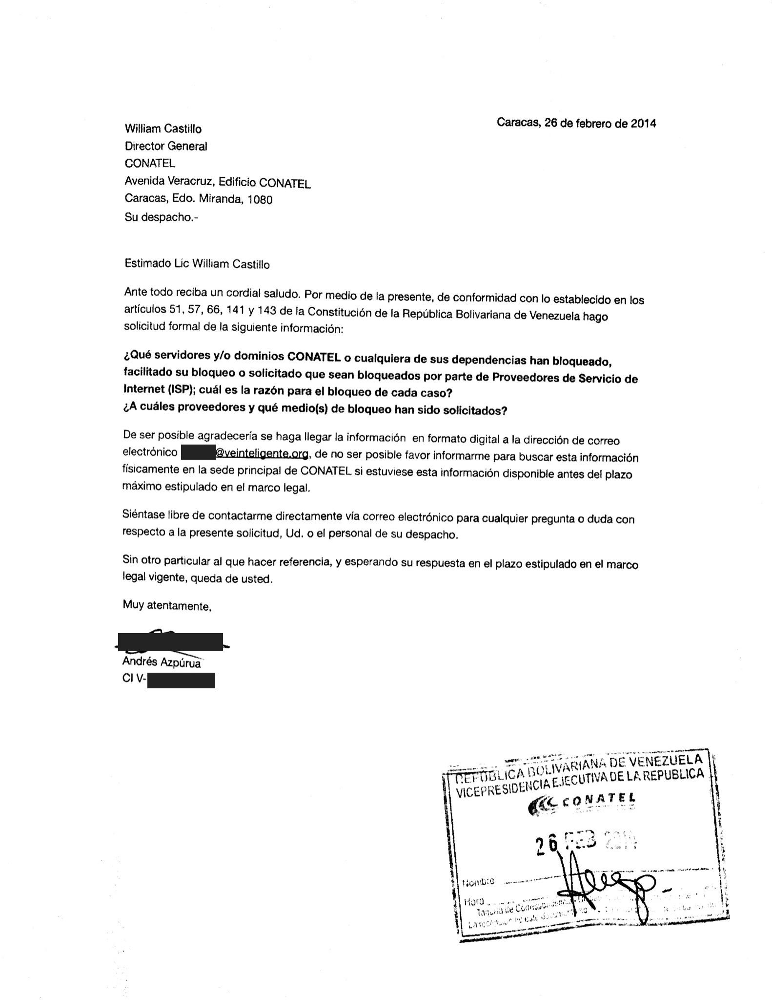
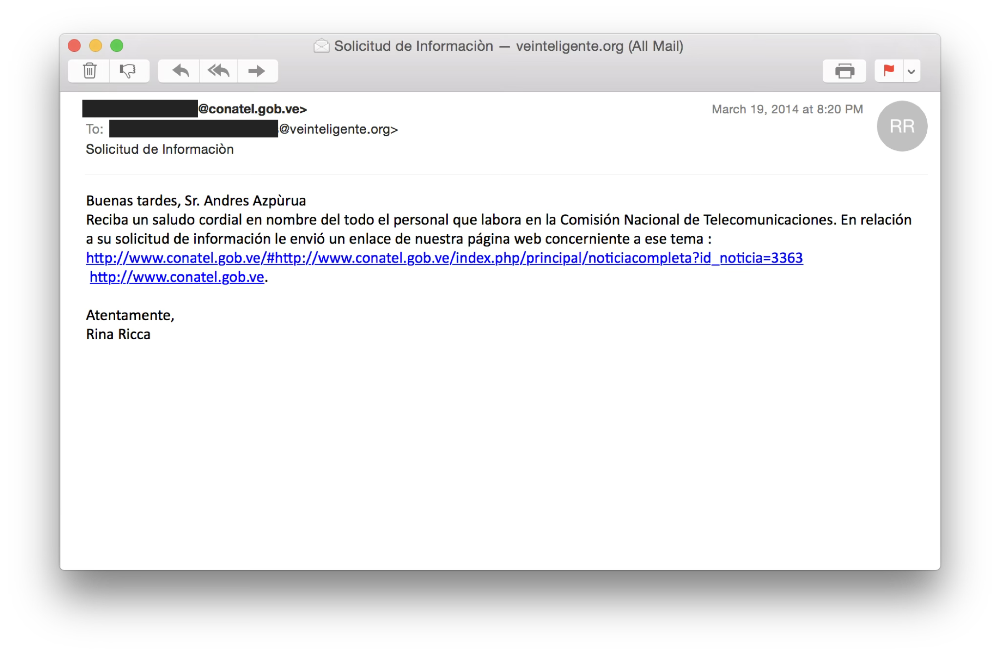

El 26 de febrero de 2014 VE sin Filtro hizo una solicitud de información pública a CONATEL, el regulador de las telecomunicaciones, sobre los bloqueos de servidores y dominios en internet solicitados a los distintos ISP.

> ¿Qué servidores y/o dominios CONATEL o cualquiera de sus dependencias han bloqueado, facilitado su bloqueo o solicitado que sean bloqueados por parte de Proveedores de Servicio de Internet (ISP); cuál es la razón para el bloqueo de cada caso? ¿A cuáles proveedores y qué medio(s) de bloqueo han sido solicitados?
>
> – William Castillo, director general de CONATEL, 26 de febrero de 2014

La única respuesta recibida, el 19 de marzo de 2014, fue un correo electrónico con un enlace a una nota sobre una solicitud para retirar contenido sobre la comercialización de especies silvestres en plataformas de comercio electrónico.

