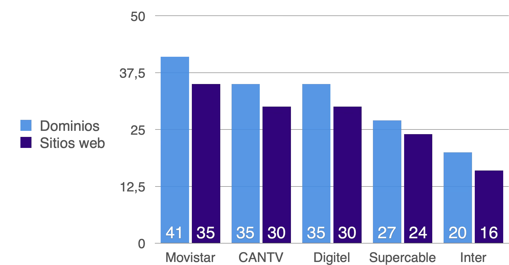
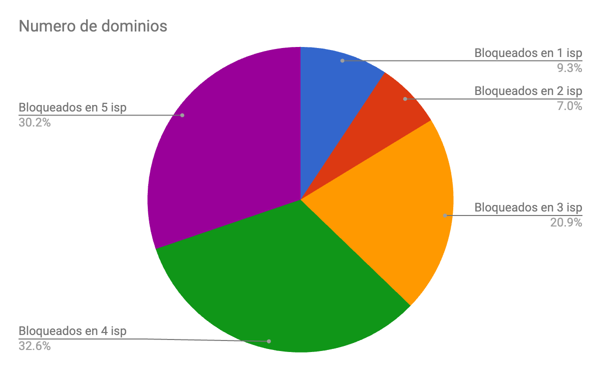
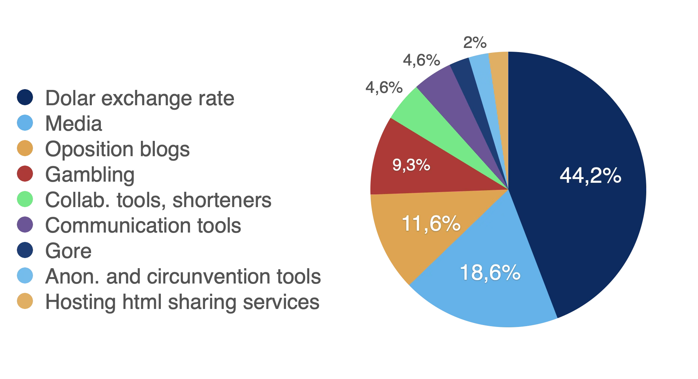
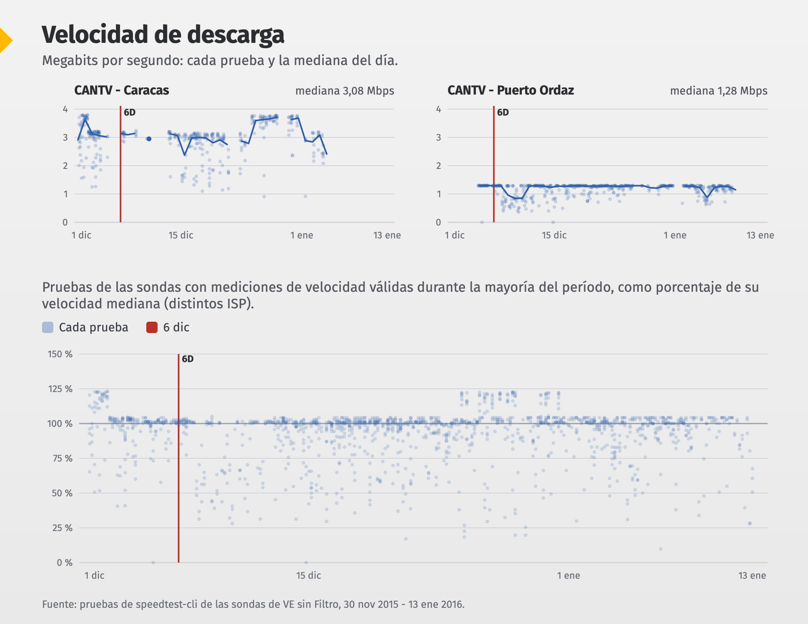
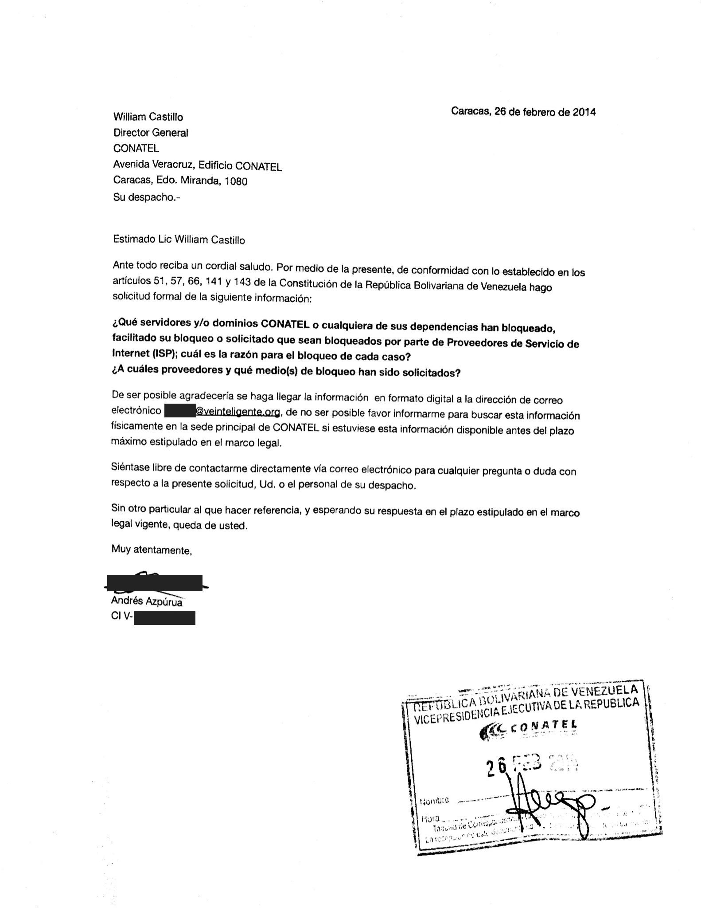
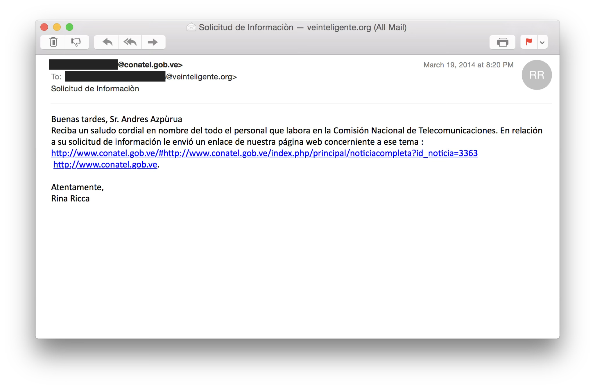
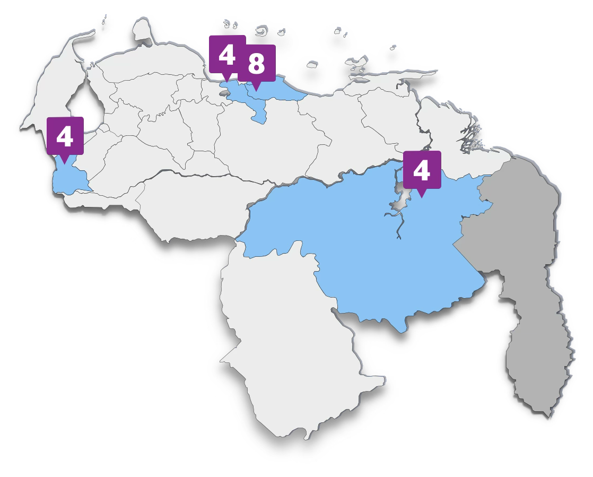

## Principales hallazgos

- Los bloqueos en internet se aplican de manera global, sin evidencia de que sean aplicados de forma diferenciada por regiones.
- Se documentó censura en los cinco principales proveedores de internet (ISP) estudiados: CANTV, Inter, Supercable, Movistar y Digitel
- No todos los sitios están bloqueados en todos los ISP, pero de forma general bloquean aproximadamente la misma lista de sitios web. Los bloqueos documentados en CANTV y Digitel coinciden 100%
- Se mantienen observaciones iniciales de VE sin Filtro que distintos ISP aplican la censura de distintas maneras.
- Esta censura se sigue aplicando en total opacidad institucional.
- Todos los bloqueos identificados en este estudio fueron de tipo DNS, a pesar de haber documentado bloqueo por IP en el pasado
- Se realizaron millones de mediciones de red y miles de mediciones de velocidad

## Introducción y motivación

El presente estudio se basa en pruebas técnicas realizadas sistemáticamente con la intención de obtener un panorama lo más completo posible de las condiciones del internet en Venezuela antes, durante y después de las elecciones legislativas de 2015.

Este trabajo de VE sin Filtro, un programa de Venezuela Inteligente, es parte del trabajo Navegar con Libertad publicado por el Instituto Prensa y Sociedad de Venezuela. El desarrollo técnico y el hardware fue de VE sin Filtro que venía desarrollando estas metodologías desde 2014. El despliegue en los puntos fuera de Caracas fue posible gracias a IPYS Venezuela y el proyecto Navegar con Libertad.

Este trabajo elabora el desarrollo metodológico y presenta análisis y conclusiones técnicas de las mediciones.

Escogimos como criterio clave para el estudio, el deseo de monitorear las posibles limitaciones de uso del internet como lo experimenta el usuario común, desde conexiones a internet fijas de tipo residencial o conexiones móviles personales.

Para cumplir este objetivo se utilizó un sistema dividido en dos partes: medición distribuida y recolección de información. Para garantizar la recolección oportuna de los resultados, se configuraron dos servidores para recibir de manera automatizada los reportes.

Se busca poder observar el desempeño de la red en el tiempo e identificar de manera clara distintos tipos de censura sobre una lista de dominios que incluyen sitios web importantes para el ejercicio del derecho a la información, libertad de expresión, derechos políticos, sitios que incluyen contenido controversial, humor político, entre otros.

## Hallazgos

Encontramos al menos 37 sitios bloqueados, incluyendo múltiples dominios distintos bloqueados para el mismo sitio, 43 dominios en total, incluyendo la página web de la aplicación de comunicación estilo “walkie-talkie” Zello y el dominio usado internamente para su funcionamiento afectando la app además del sitio web. En todos los casos observamos bloqueos de tipo DNS.

| ISP | Número de URLs web en el estudio bloqueadas | Número de sitios web en el estudio bloqueados |
|---|---|---|
| Movistar | 41 | 35 |
| CANTV | 35 | 30 |
| Digitel | 35 | 30 |
| Supercable | 27 | 24 |
| Inter | 20 | 16 |

- Todos los bloqueos identificados en este estudio fueron de tipo DNS, a pesar de haber documentado bloqueo por IP en el pasado
- Los bloqueos presentes solo en Movistar son bloqueos que previamente estaban activos en más proveedores, pero fueron levantados en ellos, mas no en Movistar

### Por categoría

|  | Number of domains | Percentage |
|---|---|---|
| Dollar exchange rate | 19 | 44,19% |
| Media | 8 | 18,6% |
| Opposition blogs | 5 | 11,63% |
| Gambling | 4 | 9,3% |
| Collab. tools, shorteners | 2 | 4,65% |
| Communication tools | 2 | 4,65% |
| Gore | 1 | 2,33% |
| Anon. and circumvention tools | 1 | 2,33% |
| Hosting html sharing services | 1 | 2,33% |

Pudimos observar bloqueos a sitios que no están activos, y bloqueos a dominios alternativos usados por los administradores del sitio web para evitar el bloqueo. Un dominio alternativo nuevo no estaría bloqueado inicialmente, pero puede ser bloqueado también y además sufre de que no es conocido por la audiencia del sitio web o hasta se puede prestar a confusión.

| URL | Sitio web | CANTV | Digitel | Inter | Supercable | Movistar |
|---|---|---|---|---|---|---|
| 6topoder.com | 6to poder | DNS | DNS | DNS |  | DNS |
| aguacateverde.com | aguacateverde.com | DNS | DNS |  |  | DNS |
| aguacateverde1.blogspot.com | aguacateverde1.blogspot.com | DNS | DNS |  | DNS | DNS |
| alekboyd.blogspot.co.uk | alekboyd.blogspot.co.uk | DNS | DNS |  | DNS | DNS |
| analisis24.com | analisis24 |  |  | DNS |  | DNS |
| dolar-paralelo.net | dolar-paralelo.net | DNS | DNS | DNS | DNS | DNS |
| dolar-permuta.com | dolar-permuta.com | DNS | DNS |  | DNS | DNS |
| dolarparalelo.biz | dolarparalelo.biz | DNS | DNS |  | DNS | DNS |
| dolarparalelo.net | dolarparalelo.net | DNS | DNS | DNS | DNS | DNS |
| dolarparalelo.org | dolarparalelo.org | DNS | DNS | DNS | DNS | DNS |
| dolarparalelo.tk | dolarparalelo.tk | DNS | DNS |  | DNS | DNS |
| dolarparalelovenezuela.com | dolarparalelovenezuela.com | DNS | DNS |  | DNS | DNS |
| dolartoday.com | Dolartoday | DNS | DNS | DNS | DNS | DNS |
| dolartoday.info | Dolartoday | DNS | DNS | DNS |  | DNS |
| dolartoday.org | Dolartoday | DNS | DNS | DNS | DNS | DNS |
| dollarparalelovenezuela.com | dollarparalelovenezuela.com | DNS | DNS |  | DNS | DNS |
| eldolarparalelo.info | eldolarparalelo.info | DNS | DNS |  |  | DNS |
| elgrandatero.com | elgrandatero.com | DNS | DNS | DNS | DNS | DNS |
| info-veraz.blogspot.com | info-veraz.blogspot.com |  |  |  | DNS | DNS |
| Infobae.com | Infobae | DNS | DNS |  | DNS | DNS |
| lahipodromodigital.com | lahipodromodigital.com | DNS | DNS | DNS | DNS | DNS |
| lechugaverde.biz | lechugaverde.biz | DNS | DNS |  | DNS | DNS |
| liberal-venezolano.blogspot.com | liberal-venezolano |  |  | DNS | DNS | DNS |
| liberal-venezolano.net | liberal-venezolano |  |  |  | DNS | DNS |
| www.minuto30.com | minuto30.com | DNS (***) | DNS (***) | DNS |  | DNS |
| muerachavez.blogspot.com | muerachavez.blogspot.com |  |  |  |  | DNS |
| www.noticias.com | noticias.com | DNS | DNS | DNS | DNS (inicio sin dato) | DNS |
| ntn24.com | Ntn24 | DNS | DNS | DNS | DNS | DNS |
| Ntn24web.com | Ntn24 | DNS | DNS | DNS | DNS | DNS |
| www.webntn24.us | Ntn24 | DNS (desde 9 de diciembre de 2015, 8:34:03 PM) | DNS (desde 10 de diciembre de 2015, 12:31:18 AM) | DNS (desde 9 de diciembre de 2015, 9:31:50 PM) |  |  |
| ovario2.com | Ovario2 | DNS | DNS |  |  | DNS |
| pastebin.com | pastebin |  |  |  | DNS |  |
| pastehtml.com | pastehtml |  |  |  |  | DNS |
| preciodolar.info | preciodolar.info | DNS | DNS |  |  | DNS |
| proxyanonimo.es | proxyanonimo.es | DNS | DNS | DNS |  | DNS |
| quelacreo.com | Que Lacreo | DNS | DNS |  |  | DNS |
| tiny.cc | tiny.cc |  |  |  |  | DNS |
| tubululu.com | tubululu.com | DNS | DNS | DNS | DNS (inicio sin dato) | DNS |
| tucadivi.com | tucadivi.com | DNS | DNS |  | DNS (inicio sin dato) | DNS |
| tuhipismo.com | tuhipismo.com | DNS | DNS | DNS | DNS (inicio sin dato) | DNS |
| vdebate.blogspot.com | vdebate.blogspot.com | DNS | DNS | DNS | DNS (inicio sin dato) | DNS |
| content.zello.com | Zello | DNS | DNS |  |  | DNS |
| zello.com | Zello | DNS | DNS |  |  | DNS |

Nota: Inicio del estudio se refiere al estudio de ese dominio en particular, incluye dominios que se agregaron al estudio luego del inicio de la captura de datos, pero siempre antes del 6 de enero.

### Cómo bloquean

La mayoría de los ISP bloquean mediante DNS

| Domain | Typical answer | CANTV, Supercable, Digitel, Movistar | Inter |
|---|---|---|---|
| dolartoday.com | 141.101.123.240, 141.101.113.240 | no answer | 127.0.0.1 |
| ntn24.com | 104.28.8.75, 104.28.9.75 | no answer | 127.0.0.1 |

### Tiempos de respuesta

|  | Primera medición con bloqueo de webntn24.us | tiempo desde el primer bloqueo |
|---|---|---|
| CANTV | 9 de diciembre de 2015, 8:34:03 PM VET GMT-4:30 | (primer bloqueo) |
| Inter | 9 de diciembre de 2015, 9:31:50 PM VET GMT-4:30 | 57 minutos y 47 segundos |
| Digitel | 10 de diciembre de 2015, 12:31:18 AM VET GMT-4:30 | 3 horas, 57 minutos, 15 segundos |

### Velocidad

En la proximidad a las elecciones del 6 de diciembre, entre el 30 de noviembre de 2015 y el 13 de enero de 2016 las sondas hicieron 2.961 pruebas de velocidad válidas. No observamos una baja de velocidad alrededor del 6 de diciembre.

Las mediciones de velocidad de este estudio no permiten hablar de las velocidades promedio en internet en Venezuela, pero sí de cambios importantes que afectan a los usuarios de forma generalizada, no observamos manipulaciones en la velocidad de conexión.

En Puerto Ordaz la velocidad de CANTV en una sonda con velocidad mediana 1,28 Mbps bajó a cerca de 0,85 Mbps, pero con mediciones altas con los mismos valores máximos, desde la tarde del 7 de diciembre hasta el 10 de diciembre. No tenemos elementos para relacionarlo con la elección, y tampoco es consistente con una degradación intencional que buscara limitar el uso de internet, en ese caso esperaríamos una bajada drástica en la velocidad máxima y la compresión de la distribución.

## Opacidad institucional

VE sin Filtro hizo una solicitud de información pública el 26 de febrero de 2014 al regulador de las telecomunicaciones, la cual no fue respondida con la información solicitada, violando la constitución y las leyes que amparan a los ciudadanos que solicitan información de carácter público.

La única respuesta recibida fue un correo electrónico con un enlace a una nota sobre una solicitud para retirar contenido sobre la comercialización de especies silvestres en plataformas de comercio electrónico.

Otra solicitud en mayo de 2014 realizada por la ONG Espacio Público tampoco tuvo respuesta satisfactoria.

## Metodología

Los sitios web que forman parte del estudio están organizados en las categorías presentadas en la siguiente tabla. Esta categorización está basada en la categorización de Citizen Lab, específicamente en una versión propuesta a la misma que discierne con más detalles unas categorías importantes para el contexto venezolano, adicionalmente se agregaron cinco categorías nuevas a la lista que eran significativas considerando los tipos de sitios web que han sido bloqueados previamente en Venezuela. Todas las categorías nuevas fueron escogidas para ser fácilmente traducibles a la categorización originalmente publicada por Citizen Lab y así poder agregar datos de distintas fuentes para otros estudios.

En este caso agregamos la categoría "Dollar exchange rate" (tasa de cambio del dólar) por el gran número de sitios similares de este tipo, que no encaja completamente en ninguna de las categorías estandarizadas. Para comparar con otros estudios, recomendamos mapear esta categoría a News, o alternativamente Economics.

|  | Categoría | Descripción |
|---|---|---|
| 1 | Alcohol & Drugs | Sites devoted to the use, paraphernalia, and sale of drugs and alcohol irrespective of the local legality. |
| 2 | Religion | Sites devoted to discussion of religious issues, both supportive and critical, as well as discussion of minority religious groups. |
| 3 | Pornography | Hard-core and soft-core pornography. |
| 4 | Provocative Attire | Websites which show provocative attire and portray women in a sexual manner, wearing minimal clothing. |
| 5 | Political Criticism | Content that offers critical political viewpoints. Includes critical authors and bloggers, as well as oppositional political organizations. Includes pro-democracy content, anti-corruption content as well as content calling for changes in leadership, governance issues, legal reform. etc. |
| 6 | Human Rights Issues | Sites dedicated to discussing human rights issues in various forms. Includes women's rights and rights of minority ethnic groups. |
| 7 | Environment | Pollution, international environmental treaties, deforestation, environmental justice, disasters, etc. |
| 8 | Terrorism and Militants | Sites promoting terrorism, violent militant or separatist movements. |
| 9 | Hate Speech | Content that disparages particular groups or persons based on race, sex, sexuality or other characteristics |
| 10 | News Media | This category includes major news outlets (BBC, CNN, etc.) as well as regional news outlets and independent media. |
| 11 | Sex Education | Includes contraception, abstinence, STDs, healthy sexuality, teen pregnancy, rape prevention, abortion, sexual rights, and sexual health services. |
| 12 | Public Health | HIV, SARS, bird flu, centers for disease control, World Health Organization, etc |
| 13 | Gambling | Online gambling sites. Includes casino games, sports betting, etc. |
| 14 | Anonymization and circumvention tools | Sites that provide tools used for anonymization, circumvention, proxy-services and encryption. |
| 15 | Online Dating | Online dating services which can be used to meet people, post profiles, chat, etc |
| 16 | Social Networking | Social networking tools and platforms. |
| 17 | LGBT | A range of gay-lesbian-bisexual-transgender queer issues. (Excluding pornography) |
| 18 | File-sharing | Sites and tools used to share files, including cloud-based file storage and P2P file-sharing tools. |
| 19 | Hacking Tools | Sites dedicated to computer security, including news and tools. Includes malicious and non-malicious content. |
| 20 | Communication Tools | Sites and tools for individual and group communications. Includes webmail, VoIP, instant messaging, chat and mobile messaging applications. |
| 21 | Media sharing | Video, audio or photo sharing platforms. |
| 22 | Hosting and Blogging Platforms | Web hosting services, blogging and other online publishing platforms. |
| 23 | Search Engines | Search engines and portals. |
| 24 | Gaming | Online games and gaming platforms, excluding gambling sites. |
| 25 | Culture | Content relating to entertainment, history, literature, music, film, books, satire and humour. |
| 26 | Economics | General economic development and poverty related topics, agencies and funding opportunities |
| 27 | Government | Government-run websites, including military sites. |
| 28 | E-commerce | Websites of commercial services and products. |
| 29 | Control content | Benign or innocuous content used as a control. |
| 30 | Other Internet tools (nuevo) | Collaboration tools, archive preservation, URL shorteners and others |
| 31 | Education (nuevo) | Universities, Research Institutes, etc. |
| 32 | Activism (nuevo) | Activism, other civil society non related directly to Human Rights |
| 33 | ISP (nuevo) | Internet Service Providers |
| 34 | Gore (nuevo) | Gore and other graphic and offensive content |

## Medición distribuida

Resultados son producidos por una red distribuida de mediciones, constituida por equipos de computación usándolos como sondas para medir el internet como lo experimenta la mayoría de los ciudadanos en Venezuela, por esto se instalaron a conexiones residenciales o conexiones móviles personales en casas de voluntarios que dieron su consentimiento informado para colaborar en el estudio.

Los equipos instalados consistían en una computadora (ordenador) de placa reducida y bajo costo *Raspberry Pi 2* conectado al router de la residencia mediante un cable de red, compartiendo la conexión a internet en la vivienda. Sólo en el caso de conexiones a redes móviles se utilizó adicionalmente un router portable TP-LINK TL-MR3040 y un módem 3G de conexión USB según la operadora.

La ubicación de las sondas fue determinada adicionalmente considerando la diversidad geográfica, importancia poblacional, historial de problemas con el acceso a internet. En cada ciudad se buscó obtener diversidad de Proveedores de Servicio de Internet (ISP por sus siglas en inglés), dependiendo de las condiciones del mercado para cada caso.

Se asignó un número de sondas mayor a Caracas por consideraciones tanto poblacionales, político-territoriales y prácticas.

Las sondas fueron preparadas y desplegadas por VE sin Filtro con un sistema operativo Debian GNU/Linux preparado para la arquitectura del procesador presente en Raspberry Pi. Adicionalmente las sondas fueron instaladas con:

- Ooni-probe versión 1.3.2, originalmente 1.3.1: Software que facilita la realización rápida de pruebas de red a una lista de puntos de medición y opcionalmente su envío  a los dominios especificados y envía la información a un servidor central.
- Tor: Un servicio para el anonimato de las comunicaciones y evadir censura en internet, usado como medición de control o referencia para algunas pruebas; así como la transmisión de resultados al servidor y la administración de las sondas de forma segura y altamente anónima.
- Un programa BASH realizado para el proyecto que realiza un número de mediciones de velocidad de internet y las guarda para ser luego enviadas periódicamente a un servidor central de manera segura.
- Python speedtest-cli: herramienta para el desarrollo y ejecución de pruebas de velocidad usando la infraestructura de medición de velocidades de [speedtest.net](http://speedtest.net) de Ookla.
- Varias dependencias del software previamente listado, herramientas básicas incluidas en el sistema operativo y herramientas utilizadas para administración de los dispositivos, programación de las pruebas y sincronización de listas y resultados. Incluyendo cron, scp, ssh.

### Pruebas realizadas

Sondas realizaron de manera automatizada las pruebas establecidas, adicionalmente en momentos específicos se corrieron manualmente sets de pruebas en las sondas o dispositivos como computadoras del equipo del proyecto para obtener puntos de datos que pudiesen ser valiosos o necesarios en el futuro.

**Pruebas de velocidad:** Una serie de pruebas de velocidad siempre contra un mismo servidor de pruebas para evaluar los cambios en las velocidades promedio (no velocidad instantánea) observadas durante las fechas para conocer el desempeño de la conexión a internet.

Cuando se llama esta prueba se realizaron tres mediciones sucesivas con un intervalo aleatorio entre 1 y 7 minutos para mitigar el impacto de mediciones puntuales con valores inusuales que puedan no ser representativas de la experiencia de navegación

Este estudio no permite conocer de las velocidades promedio o medianas en internet en Venezuela, pero sí de cambios importantes que afectan de forma generalizada a los usuarios incluyendo nuestras sondas, no observamos manipulaciones en la velocidad de conexión.

**DNS Consistency:** toma los dominios especificados en la lista y las direcciones de los servidores DNS, para luego consultar la dirección IP de cada uno de los primeros a cada uno de los segundos. Reporta cualquier error o anomalía en las respuestas, incluyendo comparación con servidores DNS de control. Detecta bloqueo de sitios web vía DNS.

**Solicitudes HTTP:** realiza una solicitud HTTP GET a cada uno de los dominios de la lista, y reporta los códigos de respuesta y el contenido obtenido del sitio web para comparar los resultados de intentar acceder normalmente y por un canal seguro de control, esto permite identificar diferencias indicativas de bloqueo de IP, censura de contenidos específicos según el contenido del sitio.

### Frecuencia de pruebas

Las pruebas eran realizadas siguiendo un cronograma diseñado para maximizar la revisión de sitios más relevantes a la elección y en mayor riesgo a ser censurados; minimizando el impacto de las mismas sobre el disfrute de la conexión a internet por los anfitriones de las sondas en sus residencias, y de esta manera favorecer su colaboración con la continuación del proyecto.

### Fallas presentadas

Durante el proceso, se observaron desconexiones de algunos dispositivos de prueba. Posibles razones de ello incluyen:

- Desconexión física del dispositivo: al estar distribuidos principalmente en hogares, los dispositivos estaban sujetos a los movimientos de los habitantes. Cables de electricidad o de conexión a internet pudieron haber sido desconectados por accidente por distintas longitudes de tiempo.
- Fallas de conexión: la conexión a internet en el país es muy inestable. Si el ISP del lugar en donde está instalado el dispositivo deja de proveer el servicio, los dispositivos no se pueden comunicar con el servidor central.
- Fallas de hardware: las sondas y sus adaptadores de corriente pueden ser susceptibles a fallas causadas por subidas o bajadas de tensión eléctrica, por falla de componentes o almacenamiento.

Todas estas causas producen el mismo efecto: la desconexión del dispositivo, esta falla en algunas ocasiones se solucionó sin intervención directa.

## Recolección de información

Los resultados de las sondas fueron recolectados y almacenados en dos servidores privados virtuales ubicados físicamente fuera del país. Los servidores fueron instalados con un sistema operativo GNU/Linux y adicionalmente:

- Ooni-backend versión 1.1.4: recibe y organiza los resultados de pruebas realizadas por el software ooniprobe en las sondas.
- Tor
- Herramientas varias incluidas en el sistema operativo, utilizadas para administración de los dispositivos, programación de tareas y sincronización de listas y resultados. Incluyen Cron, scp, ssh.

## Análisis

### Para bloqueo por DNS

Bloqueo por DNS es la medida técnica de censura de internet más comúnmente usada en Venezuela.

Cuando se quiere navegar a un sitio web, normalmente se tiene un dominio (dominio.com) y no una dirección IP, de ser así la computadora necesitará solicitar a un servidor de nombres de dominio la dirección IP para ese dominio, de forma similar a buscar en un directorio telefónico. Este servidor de nombres, o servidor DNS (Sistema de nombres de dominios por sus siglas en inglés) por defecto suele ser uno administrado por el proveedor de internet.

Cuando una página web o servicio por internet es bloqueado por DNS, el servidor DNS no responderá correctamente a la solicitud del IP correspondiente al dominio bloqueado. Esta respuesta puede tener información incorrecta, un error o negarse a responder.

El procedimiento usado para determinar bloqueo por DNS en los resultados obtenidos consiste en navegar por las respuestas de DNS en las que la respuesta de control no coincida con la respuesta obtenida por el o los servidores DNS del ISP mediante el cual la sonda se conecta a internet.

Para todos los casos de inconsistencias entre el control y el servidor DNS del ISP se debe revisar la respuesta obtenida pues hay configuraciones de DNS que normalmente pueden dar respuestas distintas, y se está observando una configuración de este tipo o no.

Si hay un error en la obtención de la dirección IP del servidor DNS de control, no se puede comparar las respuestas; sin embargo la data se puede evaluar de ser necesario en un análisis detallado, considerando respuestas anteriores y posteriores de medición y de control.

En los casos encontrados hasta ahora el bloqueo DNS ocurre de la misma manera por ISP, no dando la respuesta o respondiendo con la dirección IP 127.0.0.1, una respuesta trivial, esa dirección IP conocida como *loopback (bucle de retorno)* apunta a la misma computadora regresando cualquier tráfico a ella misma.

Cada resultado de posible censura se puede verificar con los resultados de mediciones antes y después, de esta manera se puede aproximar el punto en que dicho bloqueo inició, de haber sucedido durante el tiempo que se realizó el estudio.

### Para bloqueo por IP

El bloqueo por IP es una medida ocasionalmente utilizada en Venezuela, se ha utilizado en el pasado para evitar la difusión de información y disrumpir servicios de comunicaciones.  Consiste en impedir la comunicación hacia un servidor en internet si la dirección IP de destino se encuentra en una lista negra.

Para identificar este tipo de bloqueo en los resultados se debe buscar respuesta  a mediciones de la prueba de solicitudes HTTP donde el servidor es inaccesible al hacer la solicitud directamente pero la solicitud sí alcanza al servidor y es respondida apropiadamente al efectuar la solicitud mediante una conexión segura de Tor que no puede ser monitoreada e intervenida por el ISP o el Gobierno de Venezuela.

Si esta situación se mantiene en el tiempo sin que haya una explicación técnica para esto, se puede considerar un caso de bloqueo por IP, es posible que se tenga que hacer pruebas adicionales como una traza del tráfico para obtener confirmación final.

### Bloqueo por palabras claves y ataques de intermediario

Representa un conjunto de técnicas con mayor costo operacional y sofisticación técnica en las que se ha colocado un intermediario inesperadamente entre el servidor de destino y el de origen monitoreando el tráfico, de manera que según el contenido del tráfico pueda ejercer acciones de censura como bloquear la conexión al identificar la presencia de ciertas palabras claves (**Bloqueo por palabras claves**) en otros escenarios se podría hacer pasar por el servidor de destino y modificar o presentar un contenido distinto al del sitio original (**ataque de intermediario**).

Para identificar ambas medidas se debe observar los resultados de la prueba de solicitudes HTTP. Identificar un bloqueo por palabras claves con esa prueba no es ideal y es menos evidente que en los otros casos, y requiere una capacidad de identificar patrones de sitios que podrían parecer bloqueados por IP o presenta irregularidades solamente cuando ciertas palabras claves forman parte de la respuesta.

Para evaluar un posible ataque de intermediario, primero se debe observar los resultados de la prueba de solicitudes HTTP cuyas respuestas, tráfico normal y dirigiendo el tráfico por Tor, no coincidan, esto se puede evaluar rápidamente en el resultado obtenido que incluye una relación de la longitud de la respuesta para cada caso, usando la longitud de la respuesta como un modelo simplificado del contenido.

Los incidentes de sospecha de censura deben ser evaluados individualmente para ver si la diferencia del contenido refleja la censura, o una diferencia explicable del contenido, debe validarse comparando con las respuestas obtenidas en otros instantes.

Este trabajo fue publicado posteriormente a su elaboración.

**Actualización:** Venezuela Inteligente ahora se llama Conexión Segura y Libre.
