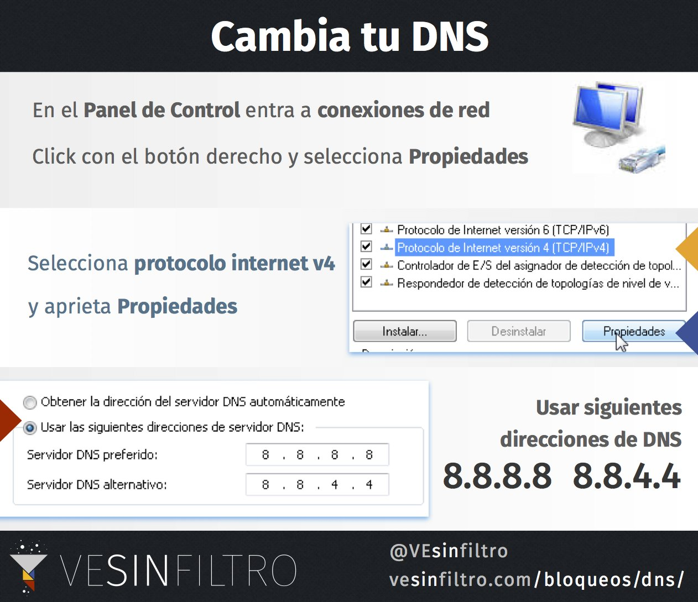

La forma más básica de evadir bloqueos no requiere descargar nada: cambiar tu DNS. Para el 1S de 2016 compartimos esta guía rápida; los pasos completos están en la [guía para cambiar los servidores DNS](/bloqueos/dns/).

<blockquote class="twitter-tweet">
La forma más básica de evadir bloqueos no requiere descargar nada: Cambiar tu DNS - guarda esta imagen <a href="https://twitter.com/hashtag/internetVE?src=hash&amp;ref_src=twsrc%5Etfw">#internetVE</a> <a href="https://t.co/nORKoRfxoR">pic.x.com/nORKoRfxoR</a>
&mdash; VE sin Filtro (@vesinfiltro) <a href="https://twitter.com/vesinfiltro/status/771342545066532864?ref_src=twsrc%5Etfw">September 1, 2016</a></blockquote>

## Links relacionados

- [Cambiar servidores DNS](/bloqueos/dns/)

