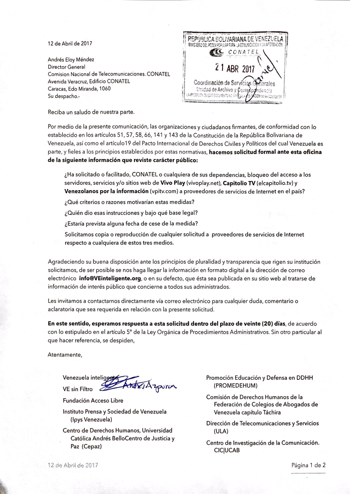

Celebremos el Día de Internet exigiéndole respuesta a CONATEL sobre los bloqueos en internet en Venezuela. Los bloqueos arbitrarios de internet implican severas restricciones a las libertades y derechos humanos en internet.

<blockquote class="twitter-tweet">
Celebremos el <a href="https://twitter.com/hashtag/diaDeInternet?src=hash&amp;ref_src=twsrc%5Etfw">#diaDeInternet</a> exigiéndole respuesta a <a href="https://twitter.com/CONATEL?ref_src=twsrc%5Etfw">@CONATEL</a> sobre los <a href="https://twitter.com/hashtag/bloqueos?src=hash&amp;ref_src=twsrc%5Etfw">#bloqueos</a> en <a href="https://twitter.com/hashtag/internetVE?src=hash&amp;ref_src=twsrc%5Etfw">#internetVE</a> <a href="https://t.co/oTpE7y5Car">pic.x.com/oTpE7y5Car</a>
&mdash; VE sin Filtro (@vesinfiltro) <a href="https://twitter.com/vesinfiltro/status/864878830657441792?ref_src=twsrc%5Etfw">May 17, 2017</a></blockquote>

Por medio de una solicitud de información pública, 8 organizaciones además de ciudadanos firmantes hicimos solicitud formal de la siguiente información sobre recientes bloqueos a medios digitales, que es de interés público:

> ¿Ha solicitado o facilitado, CONATEL o cualquiera de sus dependencias, bloqueo del acceso a los servidores, servicios y/o sitios web de Vivo Play (vivoplay.net), Capitolio TV (elcapitolio.tv) y Venezolanos por la información (vpitv.com) a proveedores de servicios de Internet en el país?
>
> ¿Qué criterios o razones motivarian estas medidas?
>
> ¿Quién dio esas instrucciones y bajo qué base legal?
>
> ¿Estaría prevista alguna fecha de cese de la medida?
>
> Solicitamos copia o reproducción de cualquier solicitud a proveedores de servicios de Internet respecto a cualquiera de estos tres medios.

**Actualización:** no tuvimos respuesta a estas preguntas. Debieron darle respuesta a la solicitud dentro del plazo de 20 días, de acuerdo con lo estipulado en el artículo 5° de la Ley Orgánica de Procedimientos Administrativos.

## Links relacionados

- [Bloqueos de internet en abril de 2017](/noticias/bloqueos_abril_2017/)
- [El director de CONATEL admite bloqueos de oficio, sin orden judicial (26 abr 2017)](/noticias/2017-04-26-conatel-bloqueos-de-oficio/)

