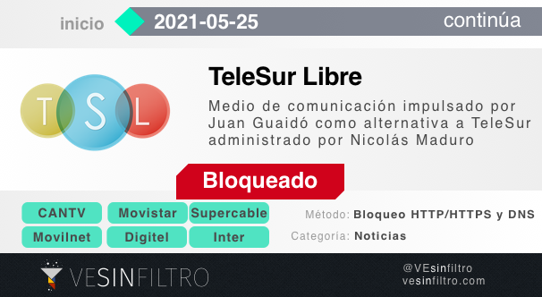
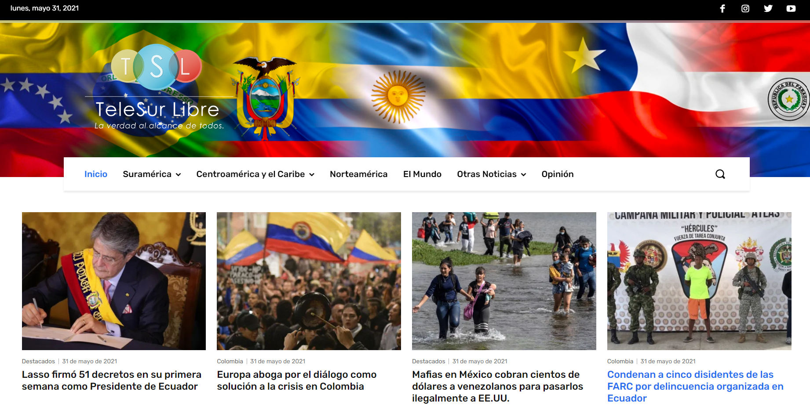

Bloquean la página web de [TeleSur Libre](https://telesurlibre.com/), un nuevo medio de comunicación apoyado por el gobierno de Juan Guaidó el cual se hizo público apenas el pasado 24 de mayo.

**El bloqueo comenzó el martes 25 de mayo en horas de la tarde y afecta a los usuarios de los mayores ISP del país: CANTV, Inter, Movistar, Digitel, Supercable y NetUno.** La inmensa mayoría de los usuarios de internet en Venezuela no puede acceder a [telesurlibre.com](https://telesurlibre.com) sin antes usar herramientas de circumvención de censura.

Los medios de noticias son la categoría de sitios web más bloqueados en Venezuela. Venezuela suele bloquear medios nacionales de todos los tamaños y múltiples medios internacionales que cubren las noticias de Venezuela en español. También se ha observado el bloqueo de importantes plataformas de streaming y de redes sociales de forma táctica para impedir la cobertura en vivo de eventos noticiosos.

Este bloqueo es una nueva vulneración al derecho a la libertad de información de los Venezolanos. La censura de fuentes de noticias coloca en una situación aún más vulnerable a los Venezolanos, que tienen que luchar para mantenerse informados frente a la prácticamente inexistentes noticias independientes en TV, desaparición de los periódicos en papel y la escasa conectividad a internet.

TeleSur Libre es una iniciativa de Juan Guaidó, reconocido como Presidente Encargado de Venezuela por múltiples países, como una alternativa a TeleSur, un medio de comunicación regional administrado por el Gobierno de Nicolás Maduro en Venezuela.

El gobierno de Maduro ya ha bloqueado otras iniciativas de Juan Guaidó, incluyendo de noticias, y hasta ha puesto en marcha [múltiples ataques de de phishing](https://vesinfiltro.com/noticias/Phishing_impulsado_por_gobierno_de_Venezuela/) contra los usuarios de [plataformas](https://vesinfiltro.com/noticias/2020-04-26-phishing_heroes_salud) organizadas por Juan Guaidó.

Desde 2019 hay una crisis sobre política e institucional en Venezuela sobre la legitimidad como presidente de Nicolás Maduro y Juan Guaidó, así como la Asamblea Nacional y Tribunal Supremo de Justicia.

CANTV implementó un bloqueo **HTTP/HTTPS** que requiere el uso de un VPN para poder evadir la censura. Por su parte Inter, Movistar, Digitel, Supercable y NetUno implementaron un bloqueo **DNS**, el cual podría evadirse simplemente cambiando los DNS de nuestros dispositivos.

## Recomendaciones

Recomendamos el uso de herramientas confiables de circunvención de bloqueos en internet por los usuarios en Venezuela, como un VPN seguro y de confianza, ya instalado y configurado en todos tus dispositivos.

### Descarga desde direcciones alternativas

A pesar del bloqueo a sus páginas web principales, tanto Psiphon como TunnelBear siguen estando disponibles para ser instaladas desde las tiendas de aplicaciones de iOS y Android, y también desde los siguientes enlaces alternativos.

Psiphon
-   [psiphon3.com](http://psiphon3.com/es/download.html)
-   [Android: Play Store](https://play.google.com/store/apps/details?id=com.psiphon3.subscription)
-   [iOS: Apple App Store](https://apps.apple.com/us/app/psiphon/id1276263909?ls=1)
-   Proxy: [https://58685.info](https://58685.info/)
-   E-mail: get@psiphon3.com

Tunnelbear
-   [Android: Play Store](https://play.google.com/store/apps/details?id=com.tunnelbear.android)
-   [iOS: Apple App Store](https://geo.itunes.apple.com/app/tunnelbear-vpn-unblock-websites/id564842283?mt=8&at=1010l9nk)
-   [tuneloso.com](http://tuneloso.com/)

Puedes seguir las instrucciones para instalar y usar Psiphon en [este video:](https://www.youtube.com/watch?v=iYQQTE1-Thk)

<iframe width="560" height="315" src="https://www.youtube-nocookie.com/embed/iYQQTE1-Thk" title="YouTube video player" frameborder="0" allow="accelerometer; autoplay; clipboard-write; encrypted-media; gyroscope; picture-in-picture" allowfullscreen></iframe>

<blockquote class="twitter-tweet" data-dnt="true">
Estas son nuestras recomendaciones para evadir <a href="https://twitter.com/hashtag/bloqueos?src=hash&amp;ref_src=twsrc%5Etfw">#bloqueos</a> en <a href="https://twitter.com/hashtag/internetVE?src=hash&amp;ref_src=twsrc%5Etfw">#internetVE</a>:  Aunque la página de <a href="https://twitter.com/PsiphonEsp?ref_src=twsrc%5Etfw">@PsiphonEsp</a> y <a href="https://twitter.com/theTunnelBear?ref_src=twsrc%5Etfw">@theTunnelBear</a> estén bloqueadas en <a href="https://twitter.com/hashtag/CANTV?src=hash&amp;ref_src=twsrc%5Etfw">#CANTV</a>, estos siguen siendo nuestros VPN recomendados.  🧵Más info en este hilo: <a href="https://t.co/SFmRM00olQ">pic.twitter.com/SFmRM00olQ</a>
&mdash; VE sin Filtro (@vesinfiltro) <a href="https://twitter.com/vesinfiltro/status/1377385735666421761?ref_src=twsrc%5Etfw">March 31, 2021</a></blockquote> 
