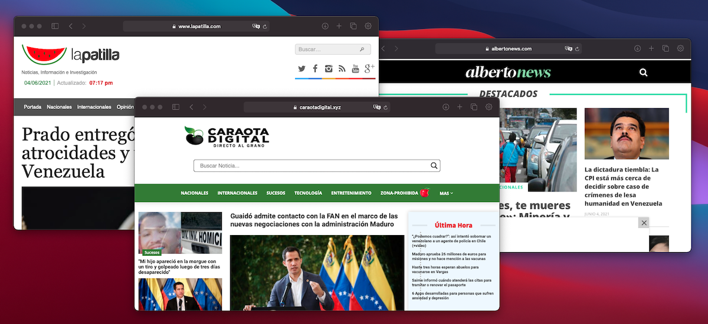
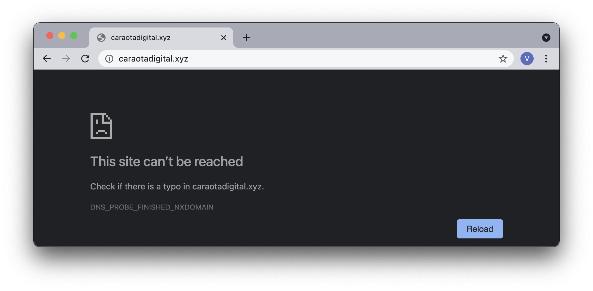
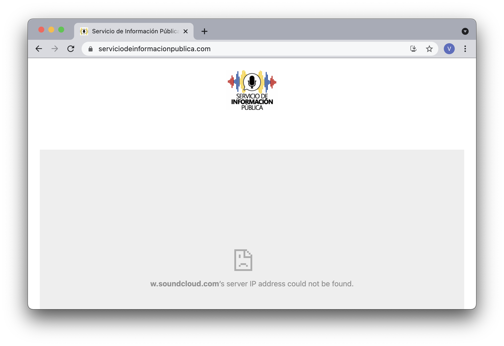

En días recientes VE sin Filtro ha podido documentar un aumento importante en bloqueos de internet contra medios de comunicación, en otro ataque contra la libertad de información y el ejercicio de los derechos humanos en el entorno digital. Los nuevos bloqueos contra afectan a La Patilla y Caraota Digital, Alberto News que ya estaban bloqueados

**El 29 de Mayo los principales proveedores de internet comenzaron a bloquear el acceso a [lapatilla.com](https://lapatilla.com), el portal web de noticias [más visitado en Venezuela](https://www.alexa.com/topsites/countries/VE).** Este bloqueo a lapatilla.com comenzó el 2021-05-29 en Digitel, Movistar, Inter y Supercable, mientras que NetUno comenzó a bloquearlo el 2021-06-01. El proveedor estatal CANTV mantiene bloqueado el dominio principal de La Patilla desde hace meses, como lo han hecho de manera intermitente durante los últimos años. A su vez, las conexiones hacia dominios alternativos de La Patilla – usados en lugar de lapatilla.com – también han sido bloqueadas en CANTV.

  <table class="blocklist">
    <thead>
      <tr>
        <th>URL</th>
        <th>Sitio</th>
        <th>CANTV</th>
        <th>Inter</th>
        <th>Supercable</th>
        <th>NetUno</th>
        <th>Movistar</th>
        <th>Digitel</th>
      </tr>
    </thead>
    <tbody>
      <tr>
        <td>https://lapatilla.com/</td>
        <td style="vertical-align: middle;" rowspan="2">La Patilla</td>
        <td class="block">Bloqueo HTTP</td>
        <td class="block">Bloqueo DNS</td>
        <td class="block">Bloqueo DNS</td>
        <td class="block">Bloqueo DNS</td>
        <td class="block">Bloqueo DNS</td>
        <td class="partial">Bloqueo DNS</td>
      </tr>
      <tr>
        <td>Dominio alternativo</td>
        <td class="partial">Bloqueo HTTP</td>
        <td class="accesible">Accesible</td>
        <td class="accesible">Accesible</td>
        <td class="accesible">Accesible</td>
        <td class="accesible">Accesible</td>
        <td class="accesible">Accesible</td>
      </tr>
      <tr>
        <td>https://caraotadigital.net/</td>
        <td style="vertical-align: middle;" rowspan="3">Caraota Digital</td>
        <td class="block">Bloqueo HTTP</td>
        <td class="block">Bloqueo DNS</td>
        <td class="block">Bloqueo DNS</td>
        <td class="block">Bloqueo DNS</td>
        <td class="block">Bloqueo DNS</td>
        <td class="block">Bloqueo DNS</td>
      </tr>
      <tr>
        <td>http://caraotadigital.xyz/</td>
        <td class="partial">Bloqueo DNS</td>
        <td class="block">Bloqueo DNS</td>
        <td class="block">Bloqueo DNS</td>
        <td class="block">Bloqueo DNS</td>
        <td class="block">Bloqueo DNS</td>
        <td class="accesible">Accesible</td>
      </tr>
      <tr>
        <td>https://caraotadigital.news</td>
        <td class="partial">Bloqueo DNS</td>
        <td class="block">Bloqueo DNS</td>
        <td class="block">Bloqueo DNS</td>
        <td class="block">Bloqueo DNS</td>
        <td class="block">Bloqueo DNS</td>
        <td class="block">Bloqueo DNS</td>
      </tr>
      <tr>
        <td>Dominio alternativo</td>
        <td>Alberto News</td>
        <td class="block">Bloqueo HTTP</td>
        <td class="accesible">Accesible</td>
        <td class="accesible">Accesible</td>
        <td class="block">Bloqueo DNS</td>
        <td class="accesible">Accesible</td>
        <td class="accesible">Accesible</td>
      </tr>
      <tr>
        <td>https://soundcloud.com</td>
        <td>SoundCloud</td>
        <td class="block">Bloqueo HTTP</td>
        <td class="accesible">Accesible</td>
        <td class="block">Bloqueo DNS</td>
        <td class="block">Bloqueo DNS</td>
        <td class="block">Bloqueo DNS</td>
        <td class="block">Bloqueo DNS</td>
      </tr>
    </tbody>
  <tfoot>
      <tr>
        <td>
            
        </td>
        <td></td>
        <td></td>
        <td></td>
        <td></td>
        <td></td>
        <td></td>
        <td class="social">
          @VEsinFiltro 
          vesinfiltro.com
        </td>
      </tr>
    </tfoot>
  </table>

Hemos observado también el **bloqueo de al menos dos dominios alternativos del portal de noticias [Caraota Digital](https://www.caraotadigital.net) usados para evadir la censura**: caraotadigital.news y caraotadigital.xyz. El acceso a Caraota Digital desde su dominio original caraotadigital.com ya había sido bloqueado el 2020-10-10. Estos nuevos bloqueos han sido aplicados por todos los proveedores privados para inicios de Junio, pero no tenemos datos del momento exacto de su inicio.

**Adicionalmente, un dominio alternativo del portal [Alberto News](http://albertonews.com) también se encuentra bloqueado por CANTV.** El uso de dominios alternativos es una práctica relativamente común para evadir bloqueos de internet, sin embargo, los portales siguen siendo vulnerables a nuevos bloqueos.

Estos eventos se suman a la larga lista de bloqueos contra la prensa en Venezuela, otro bloqueo reciente fué el bloqueo a [TeleSur Libre](https://telesurlibre.com/) el [25 de Mayo](https://vesinfiltro.com/noticias/2021-05-26_bloqueo_telesur_libre/), que nació como una iniciativa de la gestión de Juan Guaidó en contraste con TeleSur, el medio regional bajo el control del Gobierno de Nicolás Maduro.

No sólo han bloqueado los sitios web de medios no afiliados con el Gobierno de Nicolás Maduro. En los últimos años también han bloqueado plataformas de multimedia, de streaming y redes sociales en aras de limitar el acceso a las noticias.

Soundcloud, la principal plataforma de hospedaje de audio en internet, también fue bloqueada recientemente por los ISP privados este 9 de Mayo. La plataforma ya estaba bloqueada en CANTV, teniendo restringido su acceso intermitentemente desde 2019. Soundcloud es usada por medios de noticias como alternativa ante los extensos bloqueos de páginas web. El bloqueo a Soundcloud en los proveedores privados afecta la distribución de noticias en cápsulas de audio vía internet como los reportes del [Servicio de Información Pública](https://serviciodeinformacionpublica.com/), Notiaudios de El Pitazo, la distribución de algunos podcasts, entre otros.

**VE sin Filtro ha documentado también numerosos bloqueos tácticos - en momentos precisos y de poca duración - contra Youtube, Twitter, Instagram entre otras plataformas para silenciar noticias en desarrollo y su difusión en vivo.**

<blockquote class="twitter-tweet">
🛑 Bloqueado <a href="https://twitter.com/YouTube?ref_src=twsrc%5Etfw">@YouTube</a> en <a href="https://twitter.com/hashtag/CANTV?src=hash&amp;ref_src=twsrc%5Etfw">#CANTV</a> durante foro “Transición en <a href="https://twitter.com/hashtag/Venezuela?src=hash&amp;ref_src=twsrc%5Etfw">#Venezuela</a> es Posible” con la participación de Juan Guaidó  Este es otro bloqueo táctico, que busca silenciar una declaración, noticia o evento específico mientras se difunde en plataformas de alto tráfico. <a href="https://twitter.com/hashtag/internetVE?src=hash&amp;ref_src=twsrc%5Etfw">#internetVE</a> <a href="https://t.co/PeGYMUqdmc">pic.twitter.com/PeGYMUqdmc</a>
&mdash; VE sin Filtro (@vesinfiltro) <a href="https://twitter.com/vesinfiltro/status/1271178517309542408?ref_src=twsrc%5Etfw">June 11, 2020</a></blockquote> 

**Limitar el acceso a las noticias es el principal objetivo de la censura digital en Venezuela,** especialmente durante los momentos de mayor crisis política, y afecta tanto a medios nacionales como internacionales que cubren lo que ocurre en el país. Es una grave vulneración de los derechos humanos que se restrinja de tal manera el acceso a las fuentes de información y el trabajo de los periodistas.

La censura en internet en Venezuela es extensa e impide el acceso a muchos tipos de sitios web, desde medios de comunicación y ONG, hasta páginas pornográficas. Si no se utilizan técnicas de evasión de censura como VPNs o servidores DNS alternativos, es imposible acceder a decenas de portales web. Incidentalmente el gobierno de Nicolás Maduro también intenta [limitar el uso de algunas herramientas para evadir censura](https://vesinfiltro.com/noticias/2020-10-30-acceso_limitado_herramientas_anticensura/) de la misma manera.

Esto se pudo documentar utilizando mediciones de red generadas y analizadas por VE Sin Filtro que sirven como evidencia de estas interferencias al ejercicio de los derechos humanos en Venezuela. 

**Nota:** Algunos detalles menores fueron omitidos de esta alerta de forma intencional para preservar detalles de los esquemas para evadir la censura aplicados por los sitios web afectados y/o técnicas de investigación.

## Recomendaciones

Recomendamos el uso de herramientas confiables de circunvención de bloqueos en internet por los usuarios en Venezuela, como un VPN seguro y de confianza, ya instalado y configurado en todos tus dispositivos.

### Descarga desde direcciones alternativas

A pesar del bloqueo a sus páginas web principales, tanto Psiphon como TunnelBear siguen estando disponibles para ser instaladas desde las tiendas de aplicaciones de iOS y Android, y también desde los siguientes enlaces alternativos.

Psiphon
-   [psiphon3.com](http://psiphon3.com/es/download.html)

-   [Android: Play Store](https://play.google.com/store/apps/details?id=com.psiphon3.subscription)

-   [iOS: Apple App Store](https://apps.apple.com/us/app/psiphon/id1276263909?ls=1)

-   Proxy: [https://58685.info](https://58685.info/)

-   E-mail: get@psiphon3.com

Tunnelbear
-   [Android: Play Store](https://play.google.com/store/apps/details?id=com.tunnelbear.android)

-   [iOS: Apple App Store](https://geo.itunes.apple.com/app/tunnelbear-vpn-unblock-websites/id564842283?mt=8&at=1010l9nk)

-   [tuneloso.com](http://tuneloso.com/)

Puedes seguir las instrucciones para instalar y usar Psiphon en [este video:](https://www.youtube.com/watch?v=iYQQTE1-Thk)

<iframe width="560" height="315" src="https://www.youtube-nocookie.com/embed/iYQQTE1-Thk" title="YouTube video player" frameborder="0" allow="accelerometer; autoplay; clipboard-write; encrypted-media; gyroscope; picture-in-picture" allowfullscreen></iframe>

<blockquote class="twitter-tweet" data-dnt="true">
Estas son nuestras recomendaciones para evadir <a href="https://twitter.com/hashtag/bloqueos?src=hash&amp;ref_src=twsrc%5Etfw">#bloqueos</a> en <a href="https://twitter.com/hashtag/internetVE?src=hash&amp;ref_src=twsrc%5Etfw">#internetVE</a>:  Aunque la página de <a href="https://twitter.com/PsiphonEsp?ref_src=twsrc%5Etfw">@PsiphonEsp</a> y <a href="https://twitter.com/theTunnelBear?ref_src=twsrc%5Etfw">@theTunnelBear</a> estén bloqueadas en <a href="https://twitter.com/hashtag/CANTV?src=hash&amp;ref_src=twsrc%5Etfw">#CANTV</a>, estos siguen siendo nuestros VPN recomendados.  🧵Más info en este hilo: <a href="https://t.co/SFmRM00olQ">pic.twitter.com/SFmRM00olQ</a>
&mdash; VE sin Filtro (@vesinfiltro) <a href="https://twitter.com/vesinfiltro/status/1377385735666421761?ref_src=twsrc%5Etfw">March 31, 2021</a></blockquote> 
