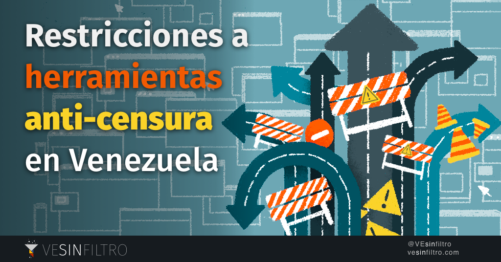
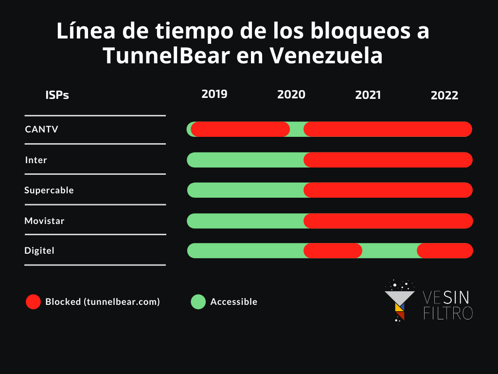
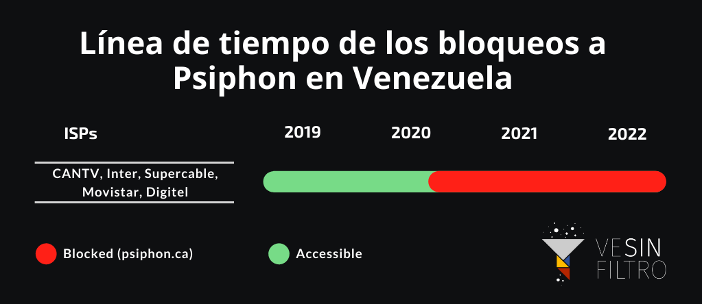

---

layout: post
title:  "Reporte: Restricciones a las herramientas de circunvención en Venezuela"
title_short: "Venezuela restringe herramientas necesarias para evadir la censura"
excerpt: "Desde el bloqueo a servidores DNS públicos hasta Tor y VPNs, Venezuela restringe herramientas anti-censura"
permalink: /noticias/2022-02-07-restriccion-herramientas-circunvencion/
date:   2022-02-07 18:20:00 -0400
categories: bloqueos
image: /res/post_img/2022-02-07/2022-02-07-es.png
type: Reporte
topics: ["Censura y bloqueos"]
lang: es
translation: /noticias/2022-02-07-restriction-circumvention-tools/
---

## Importancia de las herramientas de circunvención en Venezuela
Los venezolanos llevan más de 15 años sufriendo grandes magnitudes de censura en Internet, y cada día hay más limitaciones aplicadas para evadirla. El acceso a la información y a las noticias, así como su derecho de asociación, se ven restringidos por los bloqueos de Internet contra sitios y plataformas. Periodistas, políticos, defensores de los derechos humanos, activistas y muchos otros actores de la sociedad civil son constantemente censurados debido a los intentos del gobierno de limitar la libertad de expresión en línea en un contexto en el que los medios de comunicación independientes en la radio son escasos y censurados, y prácticamente inexistentes en la prensa escrita y la televisión.

La censura es aplicada por los principales proveedores de servicios de Internet (ISP), normalmente bajo las órdenes del regulador de las telecomunicaciones CONATEL. Sin embargo, el bloqueo más extenso y sofisticado lo realiza el ISP del estado, CANTV, el gobierno ha bloqueado con éxito el acceso a la información utilizando diferentes técnicas, desde bloqueos de DNS hasta filtrado de SNI e inyección de respuesta de DNS, que se utilizó en ataques de phishing patrocinados por el estado.

Hace apenas unos días [VE sin Filtro informó de nuevos bloqueos a cuatro organizaciones de noticias](https://vesinfiltro.com/noticias/2022-02-01-bloqueo-Noticias/) que afectaron a usuarios de seis ISP diferentes, que se suman a los [35 sitios de noticias ya bloqueados](https://vesinfiltro.com/noticias/2021-bloqueos-elecciones/) durante las recientes elecciones. Las limitaciones de los derechos humanos en el espacio digital venezolano están documentadas en el informe [Freedom on the Net 2021](https://freedomhouse.org/country/venezuela/freedom-net/2021), de Freedom House.

## Censura actual de las VPN y herramientas de circunvención

Para tener acceso a información fiable y evitar la vigilancia, los ciudadanos venezolanos tienen que utilizar diferentes herramientas y estrategias de evasión. La más eficaz ha sido el uso de servicios VPN que les han permitido ocultar su identidad y superar los bloqueos de Internet, a pesar de los intentos de limitarlos.

El cambio de los servidores DNS, configurados por defecto en un dispositivo, también es una técnica común, pero no funciona para muchos sitios bloqueados, particularmente en CANTV, quien aplica técnicas de bloqueo más complejas.

### TunnelBear

El bloqueo contra TunnelBear continúa en todos los principales ISPs de Venezuela. Su sitio web principal, tunnelbear.com, ha experimentado bloqueos de DNS además de HTTP/HTTPS simultáneamente por CANTV (AS 8048) desde 2019. El resto de los principales ISPs del país iniciaron un bloqueo de DNS el 20 de agosto de 2020.

Tunnelbear se puede descargar desde las tiendas de aplicaciones tanto en iOS como en Android, el bloqueo afecta sobre todo a los usuarios que quieren saber más (acceder a la página principal y otras URLs dependientes de esta) y a los que intentan descargarlo en su PC. El software se puede descargar en urls alternativas.

Aunque estos bloqueos no afectan a la funcionalidad del VPN en sí, durante un periodo de tiempo en el 2021 impidieron el registro de nuevos usuarios, luego de haber instalado la aplicación en el dispositivo, un paso necesario para utilizar el VPN. Esto se soluciona después de que TunnelBear se diera cuenta de este evento de bloqueo. El bloqueo actual sí afecta a los usuarios de TunnelBear que intentan cambiar sus contraseñas, ya que ese sistema depende de la accesibilidad a tunnelbear.com para poder funcionar correctamente.

### Psiphon

El sitio web principal de Psiphon, psiphon.ca, sigue bloqueado por los principales ISPs. En CANTV el sitio está afectado por un bloqueo HTTP/HTTPS + DNS, mientras que en el resto de los ISPs sólo está afectado por bloqueo DNS. El sitio ha sido bloqueado en Venezuela desde agosto de 2020, después de que la sociedad venezolana se hizo más consciente respecto al tema de los bloqueos en internet y las campañas de sensibilización entro al tema.

Estos bloqueos no afectan a la funcionalidad del VPN de ninguna manera, ni comprometen la experiencia normal del usuario de Psiphon.

### Protocolo IKEv2 VPN

Las VPN utilizan diferentes protocolos para proteger y anonimizar una conexión a internet, uno de ellos es el IKEv2, que está incorporado en muchos proveedores de VPN populares como Windscribe, Proton VPN, NordVPN, entre otros. Durante la mayor parte -si no todo- del año 2021, los usuarios de CANTV no podían establecer conexiones con ningún servicio de VPN que utiliza el protocolo IKEv2, este bloqueo fue levantado en febrero de 2022. Por cierto, IKEv2 es ahora muy poco usado, con una frecuencia casi nula, como protocolo por defecto de las aplicaciones VPN.

### Anonymouse.org

Anonymouse es un proxy web que puede utilizarse para eludir la censura, pero desaconsejamos totalmente su uso, ya que se trata de un proxy web no cifrado, lo que implica importantes riesgos para la privacidad y la seguridad. Antes estaba bloqueado en CANTV, pero actualmente sólo lo bloquean algunos proveedores privados.

  <table class="blocklist">
    <thead>
      <tr>
        <th>Website</th>
        <th>CANTV</th>
        <th>Inter</th>
        <th>NetUno</th>
        <th>Supercable</th>
        <th>Movistar</th>
        <th>Digitel</th>
      </tr>
    </thead>
    <tbody>
        <tr>
        <td>psiphon.ca</td>
        <td class="block">Bloqueo DNS+HTTP/HTTPS</td>
        <td class="block">Bloqueo DNS</td>
        <td class="block">Bloqueo DNS</td>
        <td class="block">Bloqueo DNS</td>
        <td class="block">Bloqueo DNS</td>
        <td class="block">Bloqueo DNS</td>
      </tr>
        <tr>
        <td>tunnelbear.com</td>
        <td class="block">Bloqueo DNS+HTTP/HTTPS</td>
        <td class="block">Bloqueo DNS</td>
        <td class="block">Bloqueo DNS</td>
        <td class="block">Bloqueo DNS</td>
        <td class="block">Bloqueo DNS</td>
        <td class="block">Bloqueo DNS</td>
      </tr>
        <tr>
        <td>anonymouse.org</td>
        <td class="accesible">Accesible</td>
        <td class="accesible">Accesible</td>
        <td class="block">Bloqueo DNS</td>
        <td class="block">Bloqueo DNS</td>
        <td class="block">Bloqueo HTTPS</td>
        <td class="block">Bloqueo DNS</td>
      </tr>
    </tbody>
  </table>

## Bloqueo de Tor

Tor es una reconocida herramienta que proporciona un alto nivel de anonimato al navegar en Internet y a su vez evade la censura.  Luego de un proceso de investigación hemos notado un aumento en el número de puentes y  directorios de autoridad inaccesibles desde CANTV, esto es un evento similar pero menos efectivo, que lo que ocurrió hace cuatro años aproximadamente, cuando aplicaron un bloqueo a Tor incluyendo muchos puentes públicos obfs3 y obfs4.

Esto significa que actualmente hay un esfuerzo activo para bloquear las conexiones de Tor en Venezuela, pero no es muy efectivo. Según las mediciones realizadas en los últimos meses, entre el 70% y el 80% de las autoridades de los directorios Tor están bloqueadas en cualquier momento en AS 8048. En la práctica, las conexiones Tor se establecen con éxito la mayor parte del tiempo, pero puede llevar más tiempo

El gobierno venezolano ha bloqueado Tor mediante CANTV en el pasado. En 2018 VE sin Filtro y OONI reportaron el bloqueo de conexiones de Tor incluyendo muchos puentes públicos obfs3 y obfs4, especialmente los que el Navegador Tor tiene incorporados por defecto. Aquella vez el bloqueo fue mucho más efectivo, impidiendo a los usuarios conectarse a la red Tor desde CANTV la mayor parte del tiempo.

Esta censura contra Tor opera utilizando un bloqueo TCP a estas IPs o IP:Puerto par conocidos, de forma similar a lo ocurrido en 2018. Se han bloqueado muchos puentes conocidos públicamente que no estaban incorporados.

## Bloqueo y limitación de servidores DNS

Monitoreamos el comportamiento de diferentes servidores DNS en los principales ISP nacionalmente, ya que el cambio a un servidor DNS de confianza puede mitigar la mayoría de los bloqueos que los usuarios de internet en Venezuela experimentan constantemente. Los resultados que obtuvimos siguen siendo los mismos que compartimos en nuestro [último informe](https://vesinfiltro.com/noticias/2020-10-30-limited_access_circumvention_tools/) sobre este tema.

  <table class="blocklist">
    <tr>
     <th>DNS Públicos
     </th>
     <th>IP
     </th>
     <th>CANTV
     </th>
     <th>Movistar
     </th>
     <th>Digitel
     </th>
     <th>Inter
     </th>
     <th>Supercable
     </th>
     <th>NetUno
     </th>
    </tr>
    <tr>
     <td><a href="http://a.resolvers.level3.net/">a.resolvers.level3.net</a>.
     </td>
     <td>4.2.2.1
     </td>
     <td class="accesible">OK</td>
     <td class="accesible">OK</td>
     <td class="block">Blocked</td>
     <td class="accesible">OK</td>
     <td class="accesible">OK</td>
     <td class="accesible">OK</td>
    </tr>
    <tr>
     <td><a href="http://b.resolvers.level3.net/">b.resolvers.Level3.net</a>
     </td>
     <td>4.2.2.2
     </td>
     <td class="accesible">OK</td>
     <td class="accesible">OK</td>
     <td class="block">Blocked</td>
     <td class="accesible">OK</td>
     <td class="accesible">OK</td>
     <td class="accesible">OK</td>
    </tr>
    <tr>
     <td><a href="http://c.resolvers.level3.net/">c.resolvers.level3.net</a>
     </td>
     <td>4.2.2.3
     </td>
     <td class="accesible">OK</td>
     <td class="accesible">OK</td>
     <td class="block">Blocked</td>
     <td class="accesible">OK</td>
     <td class="accesible">OK</td>
     <td class="accesible">OK</td>
    </tr>
    <tr>
     <td><strong>Cloudfare</strong>
     </td>
     <td>1.1.1.1
     </td>
     <td class="accesible">OK</td>
     <td class="block">Blocked</td>
     <td class="block">Blocked</td>
     <td class="accesible">OK</td>
     <td class="accesible">OK</td>
     <td class="accesible">OK</td>
    </tr>
    <tr>
     <td><strong>Cloudfare</strong>
     </td>
     <td>1.0.0.1
     </td>
     <td class="accesible">OK</td>
     <td class="accesible">OK</td>
     <td class="block">Blocked</td>
     <td class="accesible">OK</td>
     <td class="accesible">OK</td>
     <td class="accesible">OK</td>
    </tr>
    <tr>
     <td><a href="http://cns1.cw.net/">cns1.cw.net</a>
     </td>
     <td>141.1.1.1
     </td>
     <td class="accesible">OK</td>
     <td class="accesible">OK</td>
     <td class="block">Blocked</td>
     <td class="accesible">OK</td>
     <td class="accesible">OK</td>
     <td class="accesible">OK</td>
    </tr>
    <tr>
     <td><strong>Comodo Secure DNS</strong>
     </td>
     <td>8.26.56.26
     </td>
     <td class="accesible">OK</td>
     <td class="accesible">OK</td>
     <td class="block">Blocked</td>
     <td class="accesible">OK</td>
     <td class="accesible">OK</td>
     <td class="accesible">OK</td>
    </tr>
    <tr>
     <td><strong>Comodo Secure DNS</strong>
     </td>
     <td>8.20.247.20
     </td>
     <td class="accesible">OK</td>
     <td class="accesible">OK</td>
     <td class="block">Blocked</td>
     <td class="accesible">OK</td>
     <td class="accesible">OK</td>
     <td class="accesible">OK</td>
    </tr>
    <tr>
     <td><strong>DNS Advantage</strong>
     </td>
     <td>156.154.70.1
     </td>
     <td class="accesible">OK</td>
     <td class="accesible">OK</td>
     <td class="block">Blocked</td>
     <td class="accesible">OK</td>
     <td class="accesible">OK</td>
     <td class="accesible">OK</td>
    </tr>
    <tr>
     <td><strong>DNS Advantage</strong>
     </td>
     <td>156.154.71.1
     </td>
     <td class="accesible">OK</td>
     <td class="accesible">OK</td>
     <td class="block">Blocked</td>
     <td class="accesible">OK</td>
     <td class="accesible">OK</td>
     <td class="accesible">OK</td>
    </tr>
    <tr>
     <td><a href="http://dns-fra.de.ignite.net/">dns-fra.de.ignite.net</a>
     </td>
     <td>195.182.110.132
     </td>
     <td class="accesible">OK</td>
     <td class="accesible">OK</td>
     <td class="block">Blocked</td>
     <td class="accesible">OK</td>
     <td class="accesible">OK</td>
     <td class="accesible">OK</td>
    </tr>
    <tr>
     <td><a href="http://dns-muc.de.ignite.net/">dns-muc.de.ignite.net</a>
     </td>
     <td>62.134.11.4
     </td>
     <td class="accesible">OK</td>
     <td class="accesible">OK</td>
     <td class="block">Blocked</td>
     <td class="accesible">OK</td>
     <td class="accesible">OK</td>
     <td class="accesible">OK</td>
    </tr>
    <tr>
     <td><strong>dns1.nyc.dns-roots.net.</strong>
     </td>
     <td>208.78.24.238
     </td>
     <td class="accesible">OK</td>
     <td class="accesible">OK</td>
     <td class="block">Blocked</td>
     <td class="accesible">OK</td>
     <td class="accesible">OK</td>
     <td class="accesible">OK</td>
    </tr>
    <tr>
     <td><strong>Dyn</strong>
     </td>
     <td>216.146.35.35
     </td>
     <td class="accesible">OK</td>
     <td class="accesible">OK</td>
     <td class="block">Blocked</td>
     <td class="accesible">OK</td>
     <td class="accesible">OK</td>
     <td class="accesible">OK</td>
    </tr>
    <tr>
     <td><strong>Dyn</strong>
     </td>
     <td>216.146.36.36
     </td>
     <td class="accesible">OK</td>
     <td class="accesible">OK</td>
     <td class="block">Blocked</td>
     <td class="accesible">OK</td>
     <td class="accesible">OK</td>
     <td class="accesible">OK</td>
    </tr>
    <tr>
     <td><strong>Google DNS</strong>
     </td>
     <td>8.8.8.8
     </td>
     <td class="accesible">OK</td>
     <td class="accesible">OK</td>
     <td class="accesible">OK</td>
     <td class="accesible">OK</td>
     <td class="accesible">OK</td>
     <td class="accesible">OK</td>
    </tr>
    <tr>
     <td><strong>Google DNS</strong>
     </td>
     <td>8.8.4.4
     </td>
     <td class="accesible">OK</td>
     <td class="accesible">OK</td>
     <td class="block">Blocked</td>
     <td class="accesible">OK</td>
     <td class="accesible">OK</td>
     <td class="accesible">OK</td>
    </tr>
    <tr>
     <td><strong>Open DNS</strong>
     </td>
     <td>208.67.222.222
     </td>
     <td class="accesible">OK</td>
     <td class="accesible">OK</td>
     <td class="block">Blocked</td>
     <td class="accesible">OK</td>
     <td class="accesible">OK</td>
     <td class="accesible">OK</td>
    </tr>
    <tr>
     <td><strong>Open DNS</strong>
     </td>
     <td>208.67.222.220
     </td>
     <td class="accesible">OK</td>
     <td class="accesible">OK</td>
     <td class="block">Blocked</td>
     <td class="accesible">OK</td>
     <td class="accesible">OK</td>
     <td class="accesible">OK</td>
    </tr>
    <tr>
     <td><strong>Quad 9</strong>
     </td>
     <td>9.9.9.9
     </td>
     <td class="accesible">OK</td>
     <td class="accesible">OK</td>
     <td class="block">Blocked</td>
     <td class="accesible">OK</td>
     <td class="accesible">OK</td>
     <td class="accesible">OK</td>
    </tr>
    <tr>
     <td><strong>Quad 9</strong>
     </td>
     <td>149.112.112.112
     </td>
     <td class="accesible">OK</td>
     <td class="accesible">OK</td>
     <td class="block">Blocked</td>
     <td class="accesible">OK</td>
     <td class="accesible">OK</td>
     <td class="accesible">OK</td>
    </tr>
    <tr>
     <td><strong>Yandex</strong>
     </td>
     <td>77.88.8.8
     </td>
     <td class="accesible">OK</td>
     <td class="accesible">OK</td>
     <td class="block">Blocked</td>
     <td class="accesible">OK</td>
     <td class="accesible">OK</td>
     <td class="accesible">OK</td>
    </tr>
    <tr>
     <td><strong>Yandex</strong>
     </td>
     <td>77.88.8.1
     </td>
     <td class="accesible">OK</td>
     <td class="accesible">OK</td>
     <td class="block">Blocked</td>
     <td class="accesible">OK</td>
     <td class="accesible">OK</td>
     <td class="accesible">OK</td>
    </tr>
    <tr>
     <td><strong>Yandex Family</strong>
     </td>
     <td>77.88.8.7
     </td>
     <td class="accesible">OK</td>
     <td class="accesible">OK</td>
     <td class="block">Blocked</td>
     <td class="accesible">OK</td>
     <td class="accesible">OK</td>
     <td class="accesible">OK</td>
    </tr>
    <tr>
     <td><strong>Yandex Family</strong>
     </td>
     <td>77.88.8.3
     </td>
     <td class="accesible">OK</td>
     <td class="accesible">OK</td>
     <td class="block">Blocked</td>
     <td class="accesible">OK</td>
     <td class="accesible">OK</td>
     <td class="accesible">OK</td>
    </tr>
    <tr>
     <td><strong>Yandex safe</strong>
     </td>
     <td>77.88.8.88
     </td>
     <td class="accesible">OK</td>
     <td class="accesible">OK</td>
     <td class="block">Blocked</td>
     <td class="accesible">OK</td>
     <td class="accesible">OK</td>
     <td class="accesible">OK</td>
    </tr>
    <tr>
     <td><strong>Yandex safe</strong>
     </td>
     <td>77.88.8.2
     </td>
     <td class="accesible">OK</td>
     <td class="accesible">OK</td>
     <td class="block">Blocked</td>
     <td class="accesible">OK</td>
     <td class="accesible">OK</td>
     <td class="accesible">OK</td>
    </tr>
    <tr>
     <td><a href="http://cns2.cw.net/">cns2.cw.net</a>
     </td>
     <td>195.27.1.1
     </td>
     <td class="accesible">OK</td>
     <td class="accesible">OK</td>
     <td class="block">Blocked</td>
     <td class="accesible">OK</td>
     <td class="accesible">OK</td>
     <td class="accesible">OK</td>
    </tr>
    <tr>
     <td><a href="http://uneeda.telstra.net/">uneeda.telstra.net</a>
     </td>
     <td>139.130.4.4
     </td>
     <td class="accesible">OK</td>
     <td class="accesible">OK</td>
     <td class="block">Blocked</td>
     <td class="accesible">OK</td>
     <td class="accesible">OK</td>
     <td class="accesible">OK</td>
    </tr>
  </table>

### Digitel

Nuestras pruebas abarcan una lista de 30 servidores DNS, todos los cuales fueron bloqueados por Digitel, con la excepción del más conocido, 8.8.8.8, el servidor DNS público de Google.

Digitel bloqueó cualquier tráfico UDP o TCP en el puerto 53, independientemente de su contenido o protocolo en la capa de aplicación. Las peticiones a estos servidores desde otros puertos funcionaban cuando estaban disponibles, con la excepción de las conexiones al 8.8.8.8 de Google que no estaban bloqueadas en absoluto.

Podemos concluir que, a excepción del servidor 8.8.8.8 de Google, y de los servidores DNS utilizados internamente, todos los demás servicios DNS estándar están bloqueados para los usuarios de Digitel.

### Movistar

En el caso de Movistar, 1.1.1.1, el principal servidor DNS público de Cloudflare y APNIC, es inaccesible. Dado que el resto de los DNS más populares, incluido el 8.8.8.8 de Google, no presentan censura, es muy probable que no se trate de un caso de censura sino de un conflicto de funcionamiento interno con la dirección IP 1.1.1.1 de Movistar.

El servidor DNS alternativo 1.0.0.1 de Cloudflare es totalmente funcional, así como la aplicación móvil de Cloudflare llamada "1.1.1".

### CANTV

Aunque no se observó ningún bloqueo de servidores DNS públicos, VE sin Filtro ha documentado dos casos distintos de inyección de respuestas DNS por parte de CANTV en 2019 y 2020. En esos casos se utilizó para suplantar servidores de terceros y falsificar una respuesta que apuntaba a dominios políticamente sensibles a servidores maliciosos, como parte de una campaña de *phishing* patrocinada por el Estado. Esto demuestra el interés y la capacidad de interferir en las solicitudes de DNS realizadas a cualquier servidor de Internet. La futura manipulación del DNS o el bloqueo de los servidores DNS externos debe considerarse un riesgo importante para los usuarios de CANTV.

### DoH and DoT

Teniendo en cuenta lo anterior, se recomienda el uso de DNS sobre TLS (DoT) y DNS sobre HTTPS (DoH) cuando sea posible para mayor privacidad y seguridad, además de seleccionar un DNS externo de su elección. En los principales ISPs DoT y DoH funcionaron, con la excepción de la dirección 1.1.1.1 en Movistar que fue inalcanzable para cualquier tipo de tráfico.

  <table class="blocklist">
    

     <tr>
     <th></th>
     <th>CANTV
     </th>
     <th>Movistar
     </th>
     <th>Digitel
     </th>
     <th>Inter
     </th>
     <th>NetUno
     </th>
     <th>Supercable
     </th>
    </tr>
    <tr>
     <td>DoT
     </td>
     <td>Sin bloqueo
     </td>
     <td>Sin bloqueo, excepto 1.1.1.1
     </td>
     <td>Sin bloqueo
     </td>
     <td>Sin bloqueo
     </td>
     <td>Sin bloqueo
     </td>
     <td>Sin bloqueo
     </td>
    </tr>
    <tr>
     <td>DoH
     </td>
     <td>Sin bloqueo
     </td>
     <td>Sin bloqueo, excepto 1.1.1.1
     </td>
     <td>Sin bloqueo
     </td>
     <td>Sin bloqueo
     </td>
     <td>Sin bloqueo
     </td>
     <td>Sin bloqueo
     </td>
    </tr>
  </table>

## Métodos

La evaluación de los sitios web bloqueados se realizó analizando las mediciones de red de conectividad web de OONI producidas periódicamente desde múltiples puntos de acceso, así como otras pruebas ad-hoc.

El bloqueo de Tor se analizó utilizando las mediciones de OONI Tor producidas periódicamente desde diferentes puntos de acceso, pruebas proporcionadas por el Proyecto Tor y pruebas ad-hoc.

El funcionamiento de las diferentes herramientas y aplicaciones se verificó ejecutando las aplicaciones en diferentes días, desde diferentes puntos de acceso utilizando diferentes configuraciones y evaluando con mayor detalle cualquier problema.

## Recomendaciones

Recomendamos a los usuarios venezolanos de internet tener al menos un VPN instalado y probado en dispositivos personales como celulares y computadoras, aunque no se planee usarlas inmediatamente.

El VPN que más recomendamos es Psiphon, pero Tunnelbear también es una buena opción muy fácil de usar. Para descargarlas desde Venezuela puedes utilizar los siguientes enlaces alternativos que hasta la fecha de publicación no han sido bloqueados:

**Psiphon:**

 - psiphon3.com

  - Android: Play Store

   - iOS: Apple App Store

   - Proxy: https://58685.info

   - E-mail: get@psiphon3.com

**Tunnelbear:**

- Android: Play Store

- iOS: Apple App Store

- tuneloso.com

Recomendamos utilizar un VPN de confianza, especialmente cuando se accede a sitios web con contenido político o se participa en actividades en línea que pueden estar en conflicto con el partido gobernante en Venezuela. Además, un VPN te permite acceder a sitios web y medios de comunicación bloqueados.

Si utiliza Tor en Venezuela es aconsejable anotar una lista de puentes adicionales que posiblemente no están bloqueados, para configurar en el navegador Tor y para familiarizarse con la forma de utilizar los *Pluggable Transports* en el navegador Tor.

<iframe width="560" height="315" src="https://www.youtube-nocookie.com/embed/iYQQTE1-Thk" title="YouTube video player" frameborder="0" allow="accelerometer; autoplay; clipboard-write; encrypted-media; gyroscope; picture-in-picture" allowfullscreen></iframe>

<blockquote class="twitter-tweet" data-dnt="true">
Estas son nuestras recomendaciones para evadir <a href="https://twitter.com/hashtag/bloqueos?src=hash&amp;ref_src=twsrc%5Etfw">#bloqueos</a> en <a href="https://twitter.com/hashtag/internetVE?src=hash&amp;ref_src=twsrc%5Etfw">#internetVE</a>:  Aunque la página de <a href="https://twitter.com/PsiphonEsp?ref_src=twsrc%5Etfw">@PsiphonEsp</a> y <a href="https://twitter.com/theTunnelBear?ref_src=twsrc%5Etfw">@theTunnelBear</a> estén bloqueadas en <a href="https://twitter.com/hashtag/CANTV?src=hash&amp;ref_src=twsrc%5Etfw">#CANTV</a>, estos siguen siendo nuestros VPN recomendados.  🧵Más info en este hilo: <a href="https://t.co/SFmRM00olQ">pic.twitter.com/SFmRM00olQ</a>
&mdash; VE sin Filtro (@vesinfiltro) <a href="https://twitter.com/vesinfiltro/status/1377385735666421761?ref_src=twsrc%5Etfw">March 31, 2021</a></blockquote> 

No es mala idea cambiar de servidor DNS, siempre y cuando seas consciente de que esto no te ayuda a evadir todos los bloqueos en Venezuela ni te protege de las avanzadas manipulaciones de DNS que el Gobierno de Venezuela ha utilizado contra sus ciudadanos. Existen muchas opciones de DNS públicos, entre ellos los más reconocidos son: 8.8.8.8 y 8.8.8.4 (Google); 1.1.1.1 y 1.0.0.1 (Cloudflare y APNIC); o 9.9.9.9 y 149.112.112.112 (Quad 9). Para saber cómo cambiar las DNS de tu ordenador o dispositivo móvil, puedes consultar [este enlace](https://vesinfiltro.com/bloqueos/dns/).
