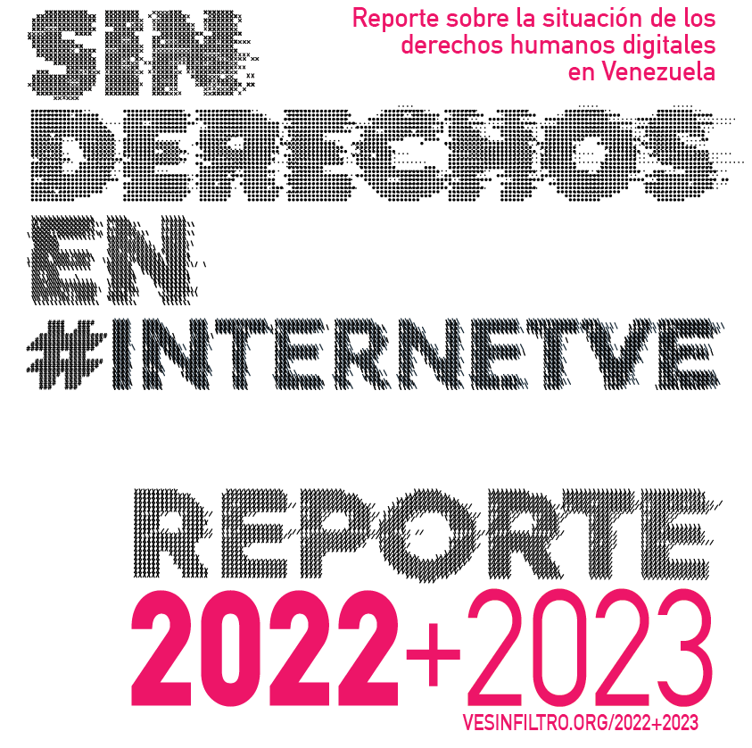

**[Descarga aquí en PDF](/res/files/reporte-2022-2023.pdf)**

Las garantías para el disfrute de los derechos digitales siguen ausentes en Venezuela. La desinversión, por un lado, y el uso discrecional del poder político por otro, impiden el desarrollo pleno de las competencias ciudadanas en Internet y han aumentado la brecha entre quienes tienen acceso y quienes no.

En Venezuela, la información es crucial debido a la compleja dinámica social que experimenta  el país. La censura en los medios tradicionales y el crecimiento global de Internet hacen que el acceso a la red sea esencial para el ejercicio de los derechos civiles y políticos. Sin embargo, se bloquean sitios web como táctica de censura. 

Más de cien URLs están bloqueadas en Venezuela, incluyendo sitios independientes de noticias. Esto limita la libertad de expresión y el acceso a la información. En los años 2022 y 2023 se mantuvieron los bloqueos bloqueos existentes y se activaron nuevos. 

Estas acciones arbitrarias no sólo afectan a la libertad de información de los ciudadanos en Venezuela, sino que también son un obstáculo a la educación, la investigación, el derecho a la libertad de asociación y el desarrollo de actividades laborales, entre muchas otras.

En relación a la conectividad a Internet, puede describirse como intermitente. Los cortes y las interrupciones de la conectividad se producen con regularidad, dejando grandes franjas del país sin conexión. 

**[Descarga aquí](/res/files/reporte-2022-2023.pdf)** nuestro informe de 2022 y 2023, SIN DERECHOS EN #INTERNETVE. 

<object data="/res/files/reporte-2022-2023.pdf" type="application/pdf" width="100%" height="600px">
      <embed src="https://docs.google.com/gview?url=https://vesinfiltro.org/res/files/reporte-2022-2023.pdf&embedded=true" width="100%" height="600px"/> 
</object>
