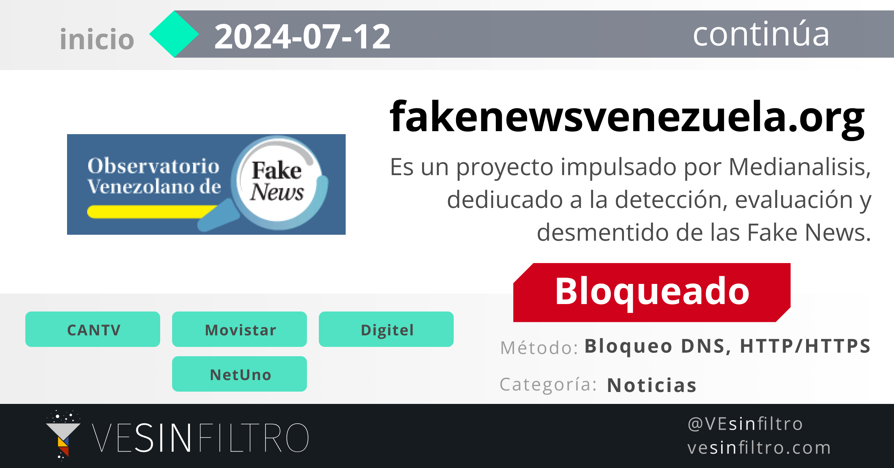

Bloquean la página del Observatorio Venezolano de Fake News (fakenewsvenezuela⸱org)

El sitio web del Observatorio Venezolano de Fake News fue bloqueado muchos de los principales operadores de Internet. De acuerdo con la revisión de #VEsinFiltro, la página tiene un bloqueo de tipo DNS en Digitel y NetUno, en Movistar es de tipo HTTP/HTTPS y en Cantv es de tipo DNS + HTTPS.

La primera medición del bloqueo se tiene de las 6 am de este 12 de julio de 2024, por lo que ocurrió entre el jueves 11 y este viernes 12.

Esta es la tercera página de FactChecking bloqueada desde el inicio de la campaña electoral. El 4 de Julio denunciamos el bloqueo contra Cazadores de Fake News y Es Paja
