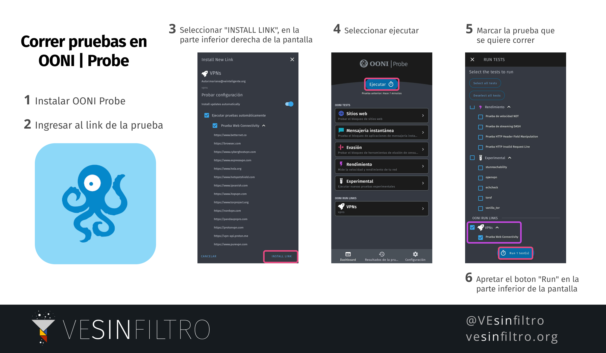

### 1.- [Instala](https://ooni.org/install/) la app móvil OONI:
* [iOS](https://itunes.apple.com/us/app/id1199566366)
* [Android](https://play.google.com/store/apps/details?id=org.openobservatory.ooniprobe)

### 2.- Corre [este link]({{page.destination}}) luego de tener la app instalada.

Esta prueba incluye sitios de medios de comunicación, con frecuencia cambiamos su contenido.

<a class="btn btn-info" href="{{page.destination}}">Corre prueba

Si quieres colaborar, puedes cargar esta página regurlarmente y apretar el boton para [correr esta prueba]({{page.destination}})
